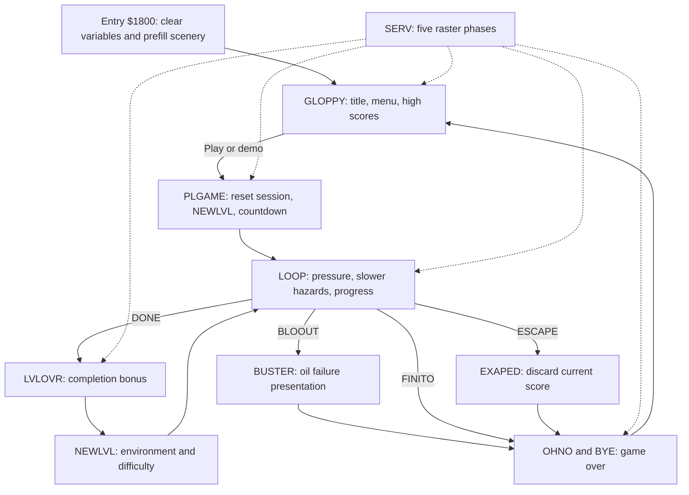

# Tycoon Tex C16 – Codebase Analysis

## Purpose, Scope, and Evidence

This document explains how the surviving Tycoon Tex implementation works, so it can be studied, modified and used as a specification for new versions on other platforms. It follows the scope of my Dorks Dilemma analysis, but works out Tycoon Tex's architecture and behavior from its own recovered modules, assembled bytes, graphics, running game and packaging.

It describes the **source revision preserved in this repository**, first published as `v1.0.0`. That revision is closely related to the running game I have, but differs from it in one initialized code byte. When I call something source behavior, it comes from instructions or data, and I don't treat comments alone as proof. Proposed architecture and improvements are labelled as proposals. The emulator checks so far show startup and gameplay entry, not a complete play-through.

Use it alongside the [generated code reference](docs/analysis/CODE_REFERENCE.md), the [machine-readable index](docs/analysis/codebase-index.json), the [asset data](docs/analysis/asset-data.json) and the [porting guide](docs/PORTING_GUIDE.md). The reference lists module locations, zero-page allocations, and symbols with their addresses and logical source-line numbers. It helps with navigation, and it doesn't claim that every label is a function.

The recovery story is in [Dorks Dilemma C16](https://github.com/anthonyjclarke/Dorks_Dilemma_C16). The [Tycoon Tex validation document](docs/SOURCE_AND_VALIDATION.md) records the restoration evidence without retelling it.

---

## Game and Verified Baseline

Tycoon Tex is a horizontally scrolling action game for the Commodore 16 and Plus/4. Tex patrols a pipeline, moves within the playfield, jumps gaps, and fires at hazards. Desert, ice, and pipe environments cycle as levels advance. Oil pressure declines over time and through damage; progress increases with movement and successful hits. Completing a level converts remaining pressure into points before the next level starts.

The source credits the concept to Matthew Clarke, Anthony Clarke, and Ian Stewart, and the programming to Micro Projects for Gremlin Graphics Ltd., with 1985 notices. I remember playing Moon Patrol and can see the resemblance, but I don't recall exactly where the concept came from. The 1992 folder records a later export, not the development date. The [artifact catalogue](docs/ARTIFACTS.md) describes the packaging and press scans.

| Property                   | Source-build baseline |
| -------------------------- | --------------------- |
| PRG load address           | `$1000` / 4096        |
| Execution entry            | `$1800` / 6144        |
| Complete PRG               | 12,290 bytes          |
| Main code and data region  | 9,203 bytes           |
| Initialized object bytes   | 9,179 bytes           |
| Reserved road buffer       | 24 bytes              |
| Object-listing differences | 0                     |
| Verified emulator model    | PAL C16, 16 KB RAM    |
| Packed reference entry     | `$100D` / `SYS 4109`  |

The PRG has a two-byte load header and 12,288 payload bytes. Its first 2 KB are graphics, so `$1000` is not the execution address and BASIC `RUN` is not the rebuilt game's entry method. The [launcher](scripts/run_vice.py) waits for machine reset, loads at the saved address, and jumps to `$1800`.

---

## Repository and Source Organization

The build selects 56 files from the 2026 disk and verifies their bytes against the supplied extraction. The older export's `INDEX` maps Commodore names to shortened PC filenames for missing modules. The main program expands 59 modules, using 36 fresh modules and 23 older fallbacks. Terrain adds ten modules and the comparison-only actor set adds six: 75 active modules in total. The available source dictionary has 84 records, including unused source and hex listings.

`Original Source Recovered/` is the preservation input. `scripts/restore_c16.py` selects, converts, assembles, packages, and validates it. `config/c16.cfg` fixes the main memory layout. `build/` contains generated assembly, listings, labels, maps, debug data, graphics blocks, reports, and emulator captures. `src/` currently provides navigation documentation; it is not an independent editable game implementation.

The raw source uses MOS-style `.LIB` includes, wildcard prefixes, `.MAC` / `.MND`, `.BYTE`, equates, and fixed origins. The converter resolves includes in the original order and preserves instructions after labels and the `DPINC` / `DPDEC` macros. The original `OBJ`, `CHAR#1`, and `CHAR#2` records are MOS Technology hex listings; they are not additional gameplay modules.

### Module Responsibilities

| Concern                 | Main module examples                 |
| ----------------------- | ------------------------------------ |
| Entry and configuration | `TYCOON-TEX`, `VARS`, `EXTRA-MEMORY` |
| Raster scheduling       | `IRQ`, `RASTER-ROUTINES`             |
| Player                  | `MOVE-SPACEY`, `PRINT-MAN`           |
| Animation and jumping   | `ANIMATIONS`, `JUMPING-CODE`         |
| Terrain                 | `PIXEL-MOVE STUFF`, `LANDSCAPE`      |
| Road construction       | `ROAD/BUILDER`, `SCR/BUFFER-ON`      |
| Menus and title         | `MAGNIFICENT`, `TITLE-PAGE`          |
| Session flow            | `PLAY-GAME`, `DIFFICULTY`            |
| Projectile and hits     | `FIRING/MEGACODE`, `EXPLOSIONS`      |
| Hazard movement         | `BASIC-ALIENS`, `INTERRUPT-ALIENS`   |
| Hazard rendering        | `ARROW-PRINT`, `JET/PLANE-PRINT`     |
| Other hazard rendering  | `BALL-PRINT`, `KAMAKAZE-PRINT`       |
| Other hazard movement   | `BOUNC/BALL-MVE`, `SUICIDE/OBJ-MOVE` |
| Ground damage           | `BREAK-IN-PIPE`                      |
| Death                   | `DEATH-MARCH !`, `SINKER !`          |
| Meters                  | `OIL-PRES/GAUGE`, `COMPLETED-GAUGE`  |
| End sequences           | `LEVEL-OVER`, `BUSTER`, `KWAHERI`    |
| Score and names         | `SCORE-ROUTINES`, `HIGH-STUFF`       |
| Input                   | `JOYSTIK`, `KEY-SCAN`                |
| Input modes             | `JO/KE SELECTION`, `DEMO-MEGA/CODE`  |
| Audio and pause         | `SOUND`, `PAUSER`                    |
| Presentation            | `FLASH-COLOURS`, `GLOP-ANIMATIONS`   |
| Text and title glyphs   | `MESSAGE-STUFF`, `WHOOPPEE-MESSAGE`  |
| Palette and actor data  | `SET-SHEET`, `CHAR-TABLES`           |
| Actor installation      | `ALIEN-CHRGET`                       |
| Other helpers           | `SETUP`, `UTILS`, `TABLES`, `MACROS` |
| Glyph transformation    | `DOUBLE-BIT`, `ROTATOR-!`            |
| Countdown               | `STARTER`                            |

`INIT-ALIENS` survives but is not included by the active main file; `DIFFICULTY` performs the active setup. `HEXER` and `BONUS` includes are commented out. `BONUS` contains a few `NOP` instructions and `RTS`, not a hidden implemented bonus system. `BACKUP-VARS` is an alternative layout and must not be combined with active `VARS` definitions.

---

## Runtime Architecture and Game States

This is a shared-memory assembly program with two interleaved execution contexts. The foreground handles menus, the slower part of gameplay, and blocking presentation sequences. Raster interrupts continue to update scrolling, input, actors, sound, and other effects. There is no single central entity manager or uniform update callback.



### Entry and Persistent Choices

Entry disables interrupts, calls `CLVARS`, clears the display through KERNAL `$FFD2`, initializes the scrolling-message pointer, constructs road data, and repeatedly scrolls ground and hills into view. It then jumps to `GLOPPY`.

The seven configuration bytes at `$1826–$182C` are embedded in the program region, outside zero-page clearing:

| Symbol   | Address | Initial value / meaning |
| -------- | ------- | ----------------------- |
| `AREA`   | `$1826` | 0, environment index    |
| `SELIVE` | `$1827` | 3, selected lives       |
| `SOFLAG` | `$1828` | 0, sound off            |
| `NUMSEL` | `$1829` | 3, Play menu selection  |
| `JOYSEL` | `$182A` | 1, joystick mode        |
| `ABLE`   | `$182B` | 0, easy                 |
| `DEMO`   | `$182C` | 0, normal input         |

`CLVARS` writes zero to `$0007–$00FF`, not to all allocated variables. It deliberately leaves `MESL`, `XHIL`, `HILCHR`, and `HILLX` at `$0002–$0006` intact. It also does not clear configuration bytes, high-score records, other writable embedded data, or hardware registers. A port should define reset policies explicitly rather than clearing an entire state structure indiscriminately.

### Title and Menu

`GLOPPY` sets `STOP` and `TITLE`, installs environment and title colors, positions Tex, initializes scrolling speeds, redraws the menu and banners, installs the IRQ, and checks the previous score. `TITLOP` delays, prints high scores, processes selection through `FUNKIT`, and waits for `EXIT`.

`NUMSEL` selects difficulty, lives, sound, play, or demo. Lives cycle from 1 to 6. Difficulty cycles easy, hard, and impossible. Sound is a boolean. `COUNTL` increments once per foreground title iteration; its eight-bit wrap starts the automatic demo. This is a loop-count timeout, not a wall-clock duration.

Title lettering temporarily replaces `$3EE8–$3F57`; `WIDTH` saves the old bytes at `DBLSVE` and copies in `DWIDTH`. `DOGBRT` restores those bytes before starting play. The same character IDs therefore have different images in title and gameplay states.

### Session and Level Setup

`PLGAME` removes Tex, clears transient variables, copies `SELIVE` into `LIVES`, and sets up screen state and the initial player pointer. It sets `LEVEL = 0` and `AREA = $FF`, then calls `NEWLVL`, which advances them to level 1 and desert. After the original countdown, it clears `STOP` and `TITLE` and enters `LOOP`.

The foreground loop waits while paused, checks game-over and escape flags, executes its difficulty-dependent busy delay, drains pressure periodically, updates the ball and crash-diving object, awards movement score and progress, handles level completion, and handles oil exhaustion.

---

## Memory Map and State Representation

| Address range    | Role                                   |
| ---------------- | -------------------------------------- |
| `$0002–$00E9`    | 232 allocated variable bytes           |
| `$00EA–$00FF`    | Outside allocated state; still cleared |
| `$0314–$0315`    | KERNAL IRQ vector replaced by `SERV`   |
| `$0400–$04A7`    | `SAVECH`, saved Tex glyphs             |
| `$0560–$05CF`    | `DBLSVE`, 112 bytes used by title      |
| `$0800–$0BE7`    | 1,000 screen attribute bytes           |
| `$0C00–$0FE7`    | 1,000 screen character bytes           |
| `$1000–$17FF`    | 256 terrain glyphs, 8 bytes each       |
| `$1800–$3BF2`    | Main program and embedded data         |
| `$25E1–$25F8`    | `SCRBUF`, within main output region    |
| `$3BF3–$3BFF`    | 13-byte zero-filled output gap         |
| `$3C00–$3FFF`    | 128-glyph upper font/actor bank        |
| `$FD30`, `$FF08` | Keyboard selection/latch access        |
| `$FF00` onward   | TED timers, video, IRQ, audio, input   |

`EXTRA-MEMORY` declares a larger possible workspace from `$0560`; the title currently uses 112 bytes there. Its comments are not a complete safe-allocation map for extensions. The current main linker region ends before `$3C00`; only 13 bytes separate the assembled region from the font, and these bytes should not be treated as meaningful expansion capacity for a new subsystem.

### Screen Pointers Are Game Coordinates

For ordinary screen positions, `address = $0C00 + row * 40 + column`. Attributes are at `address - $0400`. This relationship is repeated throughout the renderer rather than hidden behind an abstraction.

`ML` points to Tex's top-left cell. The initial `$0EA9` is row 17, column 1. `MANON` writes a 3-column by 5-row character footprint using `YVAL`; `MANOFF` erases that footprint to spaces. A pointer increment changes the player by a character cell, and adding/subtracting 40 changes a row. These are not independent floating-point world coordinates.

The HUD occupies the first three character rows. Hills use `$0C78–$0D3F`, five rows. Ground uses `$0F70` and `$0F98`, rows 22 and 23. The scrolling message starts at `$0FC0`, row 24. The gameplay area lies between the hills and ground, while Tex's resting footprint reaches row 21.

### Important State Groups

Input occupies `JLEFT` through `JFIRE`, with `JMOVE` beside them. `RND` is four bytes. `GNDX`, `HILLX`, and `MESSX` are fine-scroll phases. `WAKSPD`, `GNDSPD`, `HILSPD`, and `ANISPD` couple player position to apparent travel speed and animation.

`TITLE`, `STOP`, `PAUSE`, and `STOPAN` gate different subsets of work; none alone means that the whole program is suspended. `DEAD` requests death handling, `DEATH` tracks that sequence, `FINITO` signals session end, and `BLOOUT` signals exhausted oil. `DONE` signals level completion. Treating these overlapping flags as a single enum without documenting their combinations will change behavior.

Each hazard has position pointers and a mixture of active, print, erase, direction, and countdown flags. The full [zero-page table](docs/analysis/CODE_REFERENCE.md#zero-page-variables) gives exact addresses and sizes; the JSON index retains original comments for navigation.

---

## Interrupt Scheduling and Timing

`SETIRQ` writes `SERV` to `$0314/$0315`, enables raster interrupts, writes the first compare value, and clears `INTYPE`. The dispatcher increments `INTYPE` before selecting a handler and wraps it through five states. Each handler ends through `IRQEND`, which schedules `RASVAL[INTYPE]` and restores registers from the KERNAL IRQ stack convention.

The compare table is `$17,$41,$B0,$C0,$CC` – decimal 23, 65, 176, 192, and 204. Because the dispatcher increments first, the steady-state trigger/handler association is offset from a casual same-index reading:

| Raster compare | Handler | Principal work                      |
| -------------- | ------- | ----------------------------------- |
| `$17` / 23     | `RAST2` | Hill window; animate Tex glyphs     |
| `$41` / 65     | `RAST3` | Play window; player, death, hazards |
| `$B0` / 176    | `RAST4` | Ground window; read input           |
| `$C0` / 192    | `RAST5` | Message window; sound and stars     |
| `$CC` / 204    | `RAST1` | HUD setup; scrolling and rendering  |

These are the programmed compare values, not a promise that every register store occurs on that exact scanline. Busy work and explicit delay loops occur inside handlers. Altering a handler can move subsequent writes across visible boundaries.

`RAST1` advances ground, hills, and message scrolling. In gameplay it renders meters, explosion and hazards, advances the bullet, and checks pause/escape; in title mode it handles control selection and color effects. `RAST3` updates the RNG, player, death sequence, explosion lifetime, and IRQ-driven hazards. `RAST4` samples human or demo input. Thus a player update generally consumes a previously sampled input state; simultaneous work cannot be reordered freely.

### Foreground Work Is Not a Fixed Frame Tick

The main loop uses `DELAY+2` with `BASDLY`. Ball and crash-object movement and oil drain depend on this loop, whereas arrows, jets, bombs, jumping, and much presentation depend on raster phases. Changing CPU speed, raster cost, foreground workload, or a busy delay can change the relationship between those systems.

`DELAY+2` skips the routine's initial `LDX #$20` and accepts the caller's `X`. An initial `X = 0` wraps on decrement, producing a long 256-iteration outer delay. Replacing it with a naive zero-duration wait would break presentation and timing. Preserve the distinction between these entry points when refactoring.

A portable fixed-step implementation should first measure both update rates in representative gameplay. A nominal 50 Hz video update is a reasonable initial design choice for a PAL-style port, but assigning every original foreground iteration to one video frame is not an established faithful conversion.

---

## TED Display Model and Hardware Coupling

The game changes TED horizontal scrolling, width/mode bits, character base, and palette registers within each frame. It uses character graphics for the player and hazards; the source does not program a hardware-sprite subsystem. The relevant registers can be checked against Commodore's [TED data sheet](https://www.karlstechnology.com/commodore/TED7360-datasheet.pdf) and VICE's [TED memory implementation](https://github.com/VICE-Team/svn-mirror/blob/main/vice/src/plus4/ted-mem.c).

| Address          | Use visible in Tycoon Tex         |
| ---------------- | --------------------------------- |
| `$FF00`, `$FF02` | Timer-derived randomness          |
| `$FF07`          | Fine X scroll and character modes |
| `$FF08`          | Joystick/keyboard latch           |
| `$FF09`          | IRQ status acknowledgement        |
| `$FF0A–$FF0B`    | Raster IRQ enable and compare     |
| `$FF0E–$FF12`    | Sound frequency/control registers |
| `$FF12` bit 2    | Character fetch RAM/ROM selection |
| `$FF13`          | Character-base selection          |
| `$FF15–$FF17`    | Window background/shared colors   |
| `$FF19`          | Border color                      |

The upper glyph bank really is 1 KB at `$3C00`, not an assumed 2 KB at `$3800`. VICE's [character-base calculation](https://github.com/VICE-Team/svn-mirror/blob/main/vice/src/plus4/ted.c#L493) distinguishes 128-character reverse mode from 256-character mode. The play/HUD phases use the former; terrain phases enable the latter and select `$1000`. This distinction matters when exporting character codes and interpreting bit 7.

In multicolor glyphs, each byte supplies four two-bit pixel indices, displayed at double horizontal width. Attributes and shared window colors determine the actual palette. A one-bit font preview is useful for text; a two-bit preview is useful for actors and terrain. Neither alone reproduces the entire split-screen image.

`SETUP` clears the graphics-ROM-select bit, but does not initialize every machine register or replace the entire reset environment. The launcher starts from a normal KERNAL/BASIC reset. A bare-metal port must establish its own complete hardware state; calling the original entry on an arbitrary machine state is not equivalent.

---

## Scrolling Terrain and Procedural World Construction

The game streams scenery procedurally. It does not use Dorks Dilemma's room grid, room decompression, jigsaw collection, or maze transitions.

### Hills

`BITMVE` subtracts `HILSPD` from `HILLX`, retains its low three bits, and performs a character-column scroll when the coarse boundary is crossed. `HARHIL` shifts five rows left and asks `NEWHIL` for the next rightmost column. `NEWHIL` advances `HILCHR` down five cells per column.

The first 200 terrain glyphs encode five hill/city motifs, each eight columns by five rows. `HILLST` contains `0,40,80,120,160,40,80,120`, so selection has eight indices with repeated motif starts. `LASHIL` prevents the same selection index twice; it does not guarantee that two visibly identical motifs can never follow, because different indices can select the same start.

### Ground and Road Buffer

`GNDMVE` applies the analogous fine-scroll calculation to `GNDX`. `GNDHRD` shifts the two ground rows left. `NEWROD` inserts two character codes from `SCRBUF` at the right edge and advances `BUFPOI` by two. One buffered column consists of a bottom/top pair in the buffer; the display routine writes `SCRBUF+1` to the upper ground row and `SCRBUF` to the lower row.

`ROAD` chooses desert, ice, or pipe motifs through `AREA`. Motif tables are pairs of starting character ID and byte count. The ordinary motifs use consecutive character codes; break construction fills explicit sequences. `ONLYRD` suppresses new holes for title scenery and transitions. `RDTM`, `TPCNT`, `COUNTR`, and `CNTCMP` introduce spacing and patterned pipe variations alongside randomness.

`SCRBUF` reserves 24 bytes inside the main program region. This is a small column queue, not a framebuffer. Increasing crater widths or buffering additional terrain requires reviewing all writers, consumers, counters, and this reservation.

### Gaps and Impact Damage

`BREAK` builds a left edge, one to three selected middle sections, and a right edge in `SCRBUF`. `MAXCRA` changes the available middle-section count. Runtime `PUTBRK` operates on already displayed terrain: it first rejects overlapping break-character ranges, then writes a two-row damage pattern using `HOLECH` and `HOLEYY`. An overlapping impact still drains some oil.

The build places normal pipe characters at codes 200 onward, break characters principally at 214–233, desert at 234–243, and ice at 244–255. Artwork and collision semantics share these IDs. Renumbering tiles requires updating builders, hit tests, demo look-ahead, and render tables together.

---

## Player Movement, Animation, and Jumping

`MVESPC` runs in `RAST3`. Pause returns early. `STOP` suppresses most input-driven movement but still permits jump updating. Horizontal motion is gated by `MOVET`, normally allowing a cell move when its countdown reaches zero and resetting it to 3.

Left/right movement is disabled while `JUMPIN` is active. A horizontal move also sets `MVELR`, preventing a new jump during that update. The player pointer has fixed bounds around the resting row, with low-byte comparisons `$A9` and `$C3`. Native implementations should express bounds as coordinates and rules, while checking behavior against the original address arithmetic.

### Position Controls Travel Speed

At selected positions, `SETVAR` matches the low byte of `ML` against `COMPAR` and installs a speed profile. The player walks faster as he occupies positions farther to the right; left/right keys therefore influence both on-screen position and world travel speed.

| Profile | Screen column | Ground | Hills | Animation period |
| ------- | ------------- | ------ | ----- | ---------------- |
| 0       | 1             | 0      | 0     | 0                |
| 1       | 4             | 2      | 1     | 22               |
| 2       | 7             | 3      | 1     | 16               |
| 3       | 10            | 4      | 1     | 14               |
| 4       | 13            | 5      | 2     | 10               |
| 5       | 16            | 6      | 2     | 7                |
| 6       | 19            | 7      | 2     | 3                |
| 7       | 22            | 7      | 3     | 1                |

`BITMVE` additionally skips alternate hill updates at `WAKSPD = 1`. Intermediate positions retain the previous installed profile until a table match occurs. Ground/hill values are fine-scroll increments per relevant video update, not generic pixels per second. `WAKSPD` is the profile index; it also selects progress increments through `AMOUNT = 0,1,2,3,3,3,4,4`.

### Animation Changes Glyphs

The screen footprint uses codes 64–78. `ANIMAT` changes 48 bytes at `$3E48`, the six lower-body character cells, using four raw frames in `ANDATA`. `DECODE = 1,3,0,2` defines the frame lookup order; `TIME6 = 0,48,96,144` supplies frame offsets. The remaining body glyphs stay in place. Animation period zero is accompanied by `WAKSPD = 0`, which returns before frame advance.

A sprite-sheet port should reconstruct Tex's full 3-by-5-cell image by combining the static upper nine cells with each six-cell lower-body frame. Exporting `ANDATA` alone produces only the animated part of the character.

### Jump Path

`JUMPER` rejects a jump if `DISJUM` or `JUMPIN` is set. It initializes `JUMPY = 10` and `JTEMP = 1`. `UPJUMP` subsequently resets the cadence to 2, decrements the counter, moves up one character row for values 9 through 5, then down one row for 4 through 0. On the following negative result it clears `JUMPIN`.

The trajectory is ten discrete row moves, with a later completion event, not a parabola calculated from acceleration. It rises five rows and returns five rows. A smoother modern arc is a design change; collision opportunities, shot height, and terrain clearance must be retested if it is introduced.

---

## Collision Model and Character-Code Contracts

The screen is part of the game model. There is no separate authoritative collision map or universal bounding-box collision system.

`MANON` examines each cell it is about to draw. Any existing character code at least 92 sets `DEAD`; the routine then writes Tex's character and attribute cells. `CHKLND` examines the cell 200 bytes below `ML`, corresponding to five rows beneath the top-left player cell. It treats part of the break-code interval as fatal, while exempting particular right-edge codes and the desert/ice range. A dangerous ground hit also sets `DISJUM`.

`MANOFF` erases cells to spaces without restoring whatever was underneath. Hazard erase routines behave similarly. The observed order of erase, movement, draw, and collision reads therefore matters. Two implementations with identical object coordinates but different render order may not behave identically.

The laser reads screen characters, uses zero as an off-screen sentinel, and dispatches hit handling by numeric ranges. The demo also reads terrain codes ahead of Tex to decide whether to jump. A native port needs semantic collision categories that preserve these relationships before it can safely replace tile IDs or drawing order.

---

## Hazards, Spawning, and Projectile Rules

### Hazard Enable Mask

`ALSTAT` is a capability mask for the current level, not a list of active instances. Each hazard also has its own active and timing flags.

| Bit / mask | Meaning                     |
| ---------- | --------------------------- |
| 0 / `$01`  | Arrow enabled               |
| 1 / `$02`  | Bouncing object enabled     |
| 2 / `$04`  | Jet enabled                 |
| 3 / `$08`  | Crash-diving object enabled |
| 4 / `$10`  | Jet bomb may damage ground  |

There is one state slot for each hazard type, one falling jet bomb, one player bullet, and one explosion. A new version with multiple simultaneous instances needs collections and revised erase/collision/ownership rules rather than simply increasing a spawn counter.

### Movement and Rendering Ownership

| Hazard         | Update context | Principal entry points |
| -------------- | -------------- | ---------------------- |
| Arrow          | `RAST3`        | `IRQALI`, `PRARRO`     |
| Jet            | `RAST3`        | `IRQALI`, `PRPLAN`     |
| Jet bomb       | `RAST3`        | `MVEBMB`, `BOMPRN`     |
| Bouncer        | Foreground     | `MBALL`, `BALLS`       |
| Crash object   | Foreground     | `MSUICI`, `KAMAZ`      |
| Player bullet  | `RAST1`        | `NEWFIR`, `MVELAZ`     |
| Explosion age  | `RAST3`        | `INEXPL`, `UPEXPL`     |
| Explosion draw | `RAST1`        | `PRINTX`               |

Arrow and jet spawning require random values to meet `BSKILL` and their respective countdowns to expire. The arrow moves left by a character cell, while the jet moves right at a slower countdown and selects a bomb-release position. The bomb moves down by 40 bytes until its descent count reaches its terminal value; it may then call `PUTBRK` if bit 4 permits ground damage.

The bouncer moves diagonally left: adding 39 gives down-one-row/left-one-column motion, and subtracting 41 gives up-one-row/left-one-column motion. A vertical counter reverses its direction. The crash object initially moves left for a randomized distance, then changes to diagonal down-left motion and eventually attempts ground damage. `BULSHT` suppresses impact damage when a projectile has already destroyed a hazard.

Rendering routines consume print/erase flags and both new and old position pointers. Arrow and jet use trailing space cells in their tile layouts to erase motion trails; ball and crash object retain explicit previous-position pointers. These differing approaches should not be collapsed into one generic implementation without checking footprints.

### Player Shot and Hit Dispatch

`NEWFIR` rejects a new shot during an explosion. `MVESPC` separately prevents firing while `FIRE` is already set. The initial laser pointer is `ML + 82`, two rows and two columns from Tex's top-left cell. The laser erases its old cell, advances one character cell to the right, and inspects the new cell before drawing code 82.

`PRNTBR` restores a vertical strip of zero sentinel cells at the right edge, starting at `$0E57`. This is collision infrastructure hidden by the display window, not cosmetic artwork. Removing it can make a bullet continue through memory instead of terminating at the playfield edge.

| Screen code tested | Hit branch / award              |
| ------------------ | ------------------------------- |
| 0                  | Stop at boundary sentinel       |
| 1–91               | Continue and draw laser         |
| 92–98              | Arrow branch, 25 points         |
| 99–114             | Bouncer branch, 50 points       |
| 115–116            | Bomb branch, 250 points         |
| 117–122            | Crash-object branch, 200 points |
| 123 and above      | End shot without success award  |

The bouncer's normal visible codes are 109–114. The broader branch also covers jet codes 99–108; it should not be read as a separate implemented jet-hit routine. Reachability depends on projectile and hazard rows. Codes in these intervals must be interpreted together with the actual footprints and update order.

Successful hits add 3 progress units, start a hit sound, and usually create an explosion at the target. Explosion age selects expanding and then erasing rings through `EXSTAT` and `EXYTBL`. The documented design deliberately allows one bullet and one explosion at a time.

---

## Oil Pressure, Progress, Levels, and Difficulty

### Oil Pressure

Pressure uses a coarse byte `PRESHI` and a fine byte `PRESLO`. The visible meter has 26 character positions, with a fractional character image chosen from `PRESCH`. `NEWLVL` initializes coarse 25 and fine 7. The foreground decrements `OTEM`; when it expires, `PRESDO(1)` runs and the countdown reloads from `OILTIT`. Impacts can call the same routine with a larger amount.

The routine is not equivalent to unrestricted subtraction from a single linear integer. If the fine subtraction goes negative, it decrements the coarse component once and sets the fine component to 7, discarding the amount of fractional overshoot. A controlled VICE probe confirmed that `(10,1) - 4` becomes `(9,7)`, not `(9,5)`. `BLOOUT` is set on coarse underflow, rather than simply when both visible components first become zero. See the [probe results](docs/verification/rule-probes.json).

A port can preserve that quantization or correct it, but must choose explicitly. A mathematically cleaner resource meter changes the cost of impacts around coarse boundaries.

### Progress and Level Completion

`COMPUP` accepts a small increment, updates the low three bits of `COMPLO`, and carries into `COMPHI` on bit 3. `LOOP` awards increments from `AMOUNT` periodically while walking; successful hits add 3. The movement interval counter reloads to 24.

The routine tests the old `COMPHI` against 26 before applying a carry. The VICE probes confirmed that `(25,7) + 1` produces `(26,0)` while `DONE` remains zero; a following call sets `DONE`. This delayed completion signal is part of the surviving behavior.

`LVLOVR` waits for death processing to finish, clears hazards and motion, displays a completion message, and repeatedly trades pressure for one point until oil underflows. It then calls `NEWLVL`. The apparent wait on `DEAD` relies on interrupts continuing; a single-threaded port must convert it into a non-blocking transition state.

### Level Number and Environment Cycle

`LEVEL` is incremented in decimal mode, so ordinary levels are packed BCD, not a binary integer. `AREA` is a separate binary environment index cycling desert, ice, pipes. The first level starts at desert because `PLGAME` seeds `AREA` to `$FF` before the increment.

The code does not establish a hard stop at level 99. BCD wrap and subsequent comparisons need testing before describing behavior beyond that range. A port that stores a normal integer must translate both display and bit-mask decisions deliberately.

### Difficulty Tables and Hazard Mix

| Level band | Enabled hazard policy       |
| ---------- | --------------------------- |
| 1          | Jet                         |
| 2          | Bouncer                     |
| 3          | Crash object                |
| 4–6        | Random pair of four types   |
| 7–9        | Random triple of four types |
| 10 onward  | All four types              |

The tables `LV4TO6` and `LV7TO9` enumerate pair and triple masks. Early levels use `BSKILL = 176`, then 128, 64, and 1 for later bands. A lower threshold makes random spawn gates easier to pass. Crater selection changes after the early levels, and jet-bomb ground damage is enabled from level 7.

`TIMDLY = 24,16,8` sets the easy/hard/impossible foreground delay. `ARAB = 24,19,14` sets oil-drain tempo. These settings affect the slower hazard cadence and pressure together, rather than merely changing a universal enemy speed.

`SKLTBL = 128,100,58,1` supplies all four respawn-frequency bases. Its index is `(LEVEL & $60) >> 5`. Because `LEVEL` is BCD, changes occur across decimal level ranges 00–19, 20–39, 40–59, and 60–79, then the mask wraps at 80. The original comment describing division by 32 is not an adequate portable specification.

---

## Score, Extra Lives, and High Scores

The current score is six ASCII digit bytes at `$0C56–$0C5B`, inside the screen. `SCORE` adds the accumulator at the least significant digit. `SCORE+2` skips `LDY #5`, allowing the caller to select a higher digit with `Y`. Carry is implemented by subtracting ten and walking left through the ASCII digits; it is not a packed-BCD score representation.

This is another rendering/model dependency: changing or clearing those screen cells changes authoritative score state. A port should store a numeric score separately and render it, with tests for the original awards and overflow policy.

### Confirmed Source/Running-Version Difference

The source's `LDA SCRPOS+2` reads the thousands digit at `$0C58`; the running version's operand reads `$0C57`, the ten-thousands digit. The code compares the digit to `XTRA` and adds one life when it changes, unless `LIVES` already equals 9.

I called the original scoring routine on its own with score `000999`, three lives and cached digit zero. The source build produced `001000` and **four lives**, while the unpacked running version produced `001000` and **three lives**. That confirms an observable effect of the one-byte difference recorded earlier. It doesn't verify every score threshold or overflow case.

The cassette instructions in the scrapbook describe extra lives every 10,000 points, which fits the running-version operand. A derivative can follow either the source or the running version, but it should say which, and not treat the two as identical.

A digit-change test is not a general threshold accumulator. It grants at most one life per scoring call and caps lives at 9. Six-digit overflow and unusual large additions require separate tests before converting the score to a wider integer and claiming identical behavior.

### High-Score Records

`HISTBL` provides eight operational records, each 14 bytes: six score digits, seven name characters, and a separator byte. Additional text follows those entries, so the complete `HISTBL`-to-next-module span must not be interpreted as nine ordinary score records.

The final score is copied to the six-byte `SIKBUF`. `HIGH` compares it against the table; `MVESCR` shifts entries and inserts the score, and the name editor uses the existing directional/fire flags. Seven editable characters are stored in `STRIN`. No persistent disk-save path for the high-score table is present in the active game; values live in writable memory for the running session.

---

## Death, Oil Failure, Escape, and Demo

`UPDEAD` reacts to `DEAD` during the player raster phase. On first entry it saves the enabled-hazard mask, stops hazards and animation, saves `$A8` bytes of Tex graphics at `SAVECH`, patches the player print/erase lookup operands from `YVAL` to `FALLY`, and rotates the glyphs for the fallen pose. `SINK` gradually shifts graphic bytes and slows scrolling.

When the death countdown ends, the original graphics and lookup operands are restored, the visible lives digit and `LIVES` decrease, and either `FINITO` is set or Tex is repositioned at the left with fresh ordinary ground. This is not a complete level restart: it restores selected state and continues the session.

Oil exhaustion follows the separate `BUSTER` route, positioning Tex centrally, stopping motion, and printing a failure message from `ENDMES`. `OHNO` performs the ordinary end presentation through `BYE`, copies the score, and returns to the title. `EXAPED` resets the six score cells to zero before returning through the end route, so escape and demo do not contribute a normal final score.

`DEMOON` is a small input generator, not a recorded play-through or a general AI. It initially moves Tex toward a middle position, chooses some horizontal motion and shots from random values, and inspects a terrain cell at offset `$CB` to request a jump near gap codes. It operates through the same input flags as human control.

---

## Input, Pause, and Sound

### Input Normalization

Direction and fire flags are consumed through their sign bits, normally using `BIT` and a negative/non-negative branch. Keyboard scanning rotates the detected carry into bit 7; the lower bits may retain previous shift history. Portable code should model the meaningful boolean state while keeping input sampling order.

`REDJOS` first checks demo mode, then `JOYSEL`. Keyboard mode calls `KEY`. Joystick mode tries two latch selections and patches `XTRCDE` between `LSR A` and `NOP` to account for different fire-bit placement. It does not implement the automatic keyboard fallback claimed by the introductory `KEY-SCAN` comment. This is an example where executable control flow is more reliable than a module comment.

| Action          | Source mapping     |
| --------------- | ------------------ |
| Left / right    | `Z` / `X`          |
| Up / down       | `;` / `/`          |
| Fire / select   | Return             |
| Select keyboard | `K` on title       |
| Select joystick | `J` on title       |
| Pause           | Space during play  |
| Resume          | Commodore key      |
| Escape          | Escape during play |

`PAUSER` checks escape first and refuses pause handling while the player is dead. Pause and resume use different keys rather than one toggled action. The existing automated start test uses `JFIRE`; it does not verify host key mapping or physical joystick behavior.

### Audio

`SOUND` updates under `RAST5` when `SOFLAG` is enabled. `FIRESO` starts a channel-1 sweep with a 20-update length counter. `HITSND` starts channel-2 noise, and `UPSHIT` decrements its frequency parameter by `ALEXPF = 14` until it shuts down. Level-completion bonus code also writes audio registers directly, outside these two event routines.

The game therefore has a small effect system with shared registers and flags, not a music sequencer or sample library. A native version can send fire, hit and bonus events to an audio backend, but matching the original sound means preserving the parameter trajectories and update timing. I haven't listened to the original output in this work, so I can't vouch for how it sounds.

---

## Graphics, Text, Palettes, and Other Assets

[Illustrated Graphics](docs/GRAPHICS.md) covers the selected font and runtime glyph replacements, and shows Tex, the aliens, the pipeline, the background and the display assembly decoded from the original bytes, with the palette records, text and large lettering.

---

## Original and Modern Development Tools

`ASMC64.PRG` is a surviving C64 development executable. Its `.BAS` companion starts with `SYS(2063)` followed by an exported hex dump of its binary trailer, which doesn't mean the assembler is written in BASIC. `HYPRALOA.BAS` is the same kind of file: a `SYS3238` wrapper and binary-trailer export, not a full loader written in a high-level language.

`BOOTALL.BAS` loads `dos5.2` and `editor`, then calls their entry points, so the surviving `EDITOR.BIN` belongs with the development tools. I haven't found a Tycoon Tex level editor. The terrain is procedural, so don't read an editable map format into a file just because it's called editor. `DB1.BIN`, `DB2.BIN`, `MEGASUPE.BIN` and the loader binaries are kept, but this analysis doesn't establish what they were all for.

The modern builder uses Python, ca65, and ld65. PlatformIO's native platform supplies a build framework only; it does not compile this game as host C/C++. Release/debug environments use the same 6502 pipeline and produce identical game bytes, with labels, listings, map, and debug files. VS Code provides task entry points, while VICE provides execution and monitor inspection.

---

## Self-Modifying Code and Layout Dependencies

| Mechanism                   | Why it matters for modification        |
| --------------------------- | -------------------------------------- |
| `XTRCDE` opcode patch       | Joystick fire-bit normalization        |
| `MANL+1/+2`, `MANO+1/+2`    | Switch player draw/erase lookup tables |
| `SCORE+2` alternate entry   | Caller supplies digit index in `Y`     |
| `DELAY+2` alternate entry   | Caller supplies delay count in `X`     |
| Writable embedded records   | Menu, scores, buffers share code area  |
| Glyph RAM replacement       | Animation and presentation are writes  |
| `TITTOP` / `CHSY` adjacency | Implicit table terminator              |
| Numeric tile intervals      | Rendering codes determine collision    |

The program needs writable executable memory for the opcode/operand patches. Putting the entire code region in read-only flash is not a faithful relocation. A higher-level port should express those switches as explicit data or function parameters. A new assembly build should introduce named alternate-entry labels before changing the instruction layout around offset entry points.

The IRQ return sequence assumes the KERNAL saved registers before dispatching through its vector. Reusing `SERV` as a raw hardware interrupt entry on another system would require a different prologue/epilogue. Shared foreground/IRQ scratch pointers and interrupt-enable assumptions also require review before adding reentrant calls or asynchronous workers.

---

## Routine Contracts and Useful Inspection Points

The source has no formal calling convention that preserves all registers. Most routines freely change `A`, `X`, `Y`, flags, and shared scratch variables. Treat live CPU state and execution context as part of a routine's contract; the following is a guide to primary inputs and effects rather than a complete register-clobber specification.

| Entry     | Primary input / effect                     |
| --------- | ------------------------------------------ |
| `SCORE`   | `A`: units to add to six-digit score       |
| `SCORE+2` | `A`: addition; `Y`: chosen digit index     |
| `PRESDO`  | `A`: pressure cost; may set `BLOOUT`       |
| `COMPUP`  | `A`: small progress increment              |
| `INEXPL`  | `X/Y`: target screen address, low/high     |
| `PUTBRK`  | `X/Y`: impact screen address, low/high     |
| `KEYIT`   | `A`: mask; `Y`: row; carry means pressed   |
| `DELAY+2` | `X`: busy-delay count; zero wraps          |
| `MANON`   | `ML`: position; writes and tests footprint |
| `NEWROD`  | Consume one paired terrain-buffer column   |
| `NEWLVL`  | Advance BCD level; rebuild level state     |

`NEWLVL`, transition routines, and title/name-entry code are foreground operations and may enable interrupts or depend on them. They are not general interrupt-safe utilities. The drawing and physics routines also share pointers and temporary variables, so reentrancy needs an explicit redesign.

For monitor investigation, useful fixed baseline addresses are `FUNKIT = $28D4` immediately before menu input handling, `LOOP = $2A24` for foreground gameplay, `SCORE = $3245`, `LVLOVR = $38A2`, and `NEWLVL = $3A31`. These values belong to the current source build and must be regenerated after layout changes. The generated reference and `build/tycoon.labels` are authoritative for a newly assembled variant.

---

## Code Statistics and How to Interpret Them

The reproducible static report counts **8,730 logical lines** across 59 main modules, **3,275 instruction-like source lines**, **747 main symbol definitions**, and **586 direct symbolic/numeric transfer sites**. Comment and blank lines are included in logical line totals. Macro-body instructions are source lines, not an executed instruction count; branch labels, data, equates, and variables are included in symbols.

The listing-derived main-region allocations below include both code and embedded data. They measure storage, not runtime cost or isolated function size.

| Module             | Main-region bytes |
| ------------------ | ----------------- |
| `HIGH-STUFF`       | 513               |
| `TITLE-PAGE`       | 435               |
| `CHAR-TABLES`      | 432               |
| `KWAHERI`          | 329               |
| `INTERRUPT-ALIENS` | 327               |
| `TABLES`           | 324               |
| `FIRING/MEGACODE`  | 319               |
| `SCREEN-SETUP`     | 315               |
| `WHOOPPEE-MESSAGE` | 292               |
| `RASTER-ROUTINES`  | 262               |

`VARS` is the largest raw text input among main modules at 6,243 bytes, but allocates zero-page state rather than adding a corresponding block of executable payload. `OBJ` is a large comparison listing, not a large gameplay module. These distinctions avoid misleading optimization targets.

The machine-readable direct-transfer list identifies source module, logical line, operation, operand, and resolved destination where possible. It is not a complete call graph: ordinary fall-through, vector dispatch, modified operands, macro expansion, and all execution paths are outside that static list's coverage.

---

## Modification Map and Suggested Learning Sequence

| Desired change               | Read first                             |
| ---------------------------- | -------------------------------------- |
| Starting lives/menu defaults | `TYCOON-TEX`, `ALTERABLES`             |
| Travel speed and animation   | `MOVE-SPACEY`, `ANIMATIONS`            |
| Jump height/cadence          | `JUMPING-CODE`, `PRINT-MAN`            |
| Terrain patterns/gap widths  | `ROAD/BUILDER`, `BREAK-IN-PIPE`        |
| Difficulty and spawns        | `DIFFICULTY`, both hazard schedulers   |
| Level colors                 | `SET-SHEET`, `RASTER-ROUTINES`         |
| Environment-specific actors  | `CHAR-TABLES`, `ALIEN-CHRGET`          |
| Score awards and extra lives | `FIRING/MEGACODE`, `SCORE-ROUTINES`    |
| Pressure and progress        | Both gauge modules, `PLAY-GAME`        |
| Keyboard/control bindings    | `KEY-SCAN`, `JOYSTIK`, `PAUSER`        |
| Presentation text            | `WHOOPPEE-MESSAGE`, `TABLES`           |
| Add multiple projectiles     | Firing, explosions, render/collision   |
| New platform backend         | [Porting guide](docs/PORTING_GUIDE.md) |

A useful reading order is entry and reset, title/session state, raster scheduling, scrolling and player movement, hazards and collision, then gauges/scoring and transitions. Use generated labels to inspect the same routines in VICE and compare memory changes with source expectations. Treat modifications as hypotheses with a concrete observable result, not merely edits that still assemble.

The default builder validates against the historical object listing on purpose. It has no variant override directory, no relaxed-validation switch and no non-C16 target, so modified source is expected to fail the preservation checks. The [porting guide](docs/PORTING_GUIDE.md) sketches a separate variant workflow and test strategy, and none of those future targets exist yet.

---

## Verified Findings, Open Questions, and Next Experiments

The [isolated VICE probes](docs/verification/rule-probes.json) cover five observations: source and running-version scoring across 999 points, pressure subtraction across a coarse boundary, progress crossing into coarse 26, and the completion call that follows. They use a tiny caller in free workspace with interrupts disabled and decimal mode cleared, and the original game instructions are untouched. They check the chosen routines under controlled state. They say nothing about interrupt concurrency or complete gameplay.

There's still a lot I haven't done: full keyboard and joystick verification, listening to the sound, collision edge cases, last-life transitions, level progression over several environment cycles, high-score insertion boundaries, BCD level wrap and six-digit score overflow. I also haven't captured timing profiles or long deterministic traces.

Two things in the source look worth auditing, though I won't claim a fix I haven't verified. `UPLZSO` updates `SOU2HI` on a channel-1 sweep borrow, which sits oddly with the surrounding channel-1 logic. And the comments around randomness, input fallback and some update ownership disagree with the active instructions. For example, `SETUP` seeds `RND` from `RASCOM`, the raster-compare register, even though its comment mentions timers. `RANDOM` later reads timer registers and uses carry-sensitive arithmetic. A portable RNG has to say whether it reproduces that CPU and hardware dependency or substitutes a new deterministic generator.

I understand the one-byte scoring revision well enough now to offer a deliberate choice between the source and running-version rules. The other oddities deserve the same treatment: keep the preservation baseline, write a focused test, record what it shows, and only then add an optional corrected or redesigned behavior in a derivative.

---

## Regenerating the Developer Reference

```sh
./build.sh
python3 scripts/analyze_codebase.py
```

The analysis script reads the preserved inputs and verified build, then regenerates `docs/analysis/CODE_REFERENCE.md`, `codebase-index.json`, `asset-data.json`, and three SVG atlases. It checks that listing-derived ownership covers all 9,203 main-region bytes. It does not modify the recovered files, game instructions, or preservation builder.

To rebuild the assembled graphics figures and walk animation, use Python with Pillow 10.1 or later installed:

```sh
python3 scripts/render_game_graphics.py
```

The renderer reads the exported asset bytes, `docs/images/restored-gameplay.png` and the RGB palette saved in `docs/analysis/graphics/graphics-manifest.json`. It writes five PNG diagrams, one GIF and a manifest with the input hashes, palette provenance, image dimensions, output hashes and the illustrative GIF timing. You don't need an emulator or a new gameplay capture to regenerate the figures. To use a different TED palette, pass `--palette /path/to/vice/PLUS4/colodore_ted.vpl`, which must contain 128 RGB entries. The script checks its fixed screenshot crop against the dimensions of the verified capture.

To refresh the isolated behavior probes, run the existing VICE verification first so the packed-reference memory capture is current:

```sh
python3 scripts/verify_vice.py
python3 scripts/probe_gameplay_rules.py
```

The probe output is `build/rule-probes/rule-probes.json`. The copy under `docs/verification/` holds the observations described here, and I refresh it as a deliberate review step. [Testing](TESTING.md) covers the eight preservation tests and what they do and don't check.
