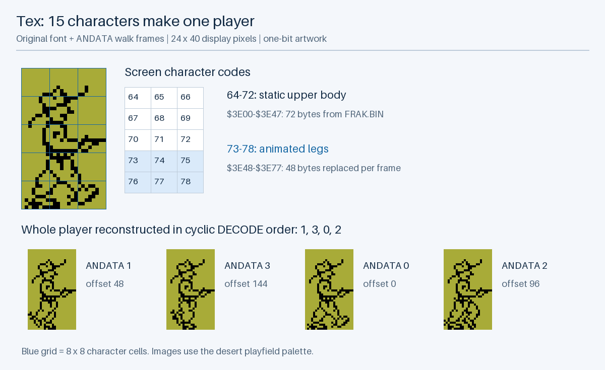
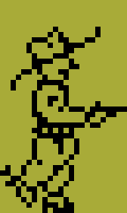
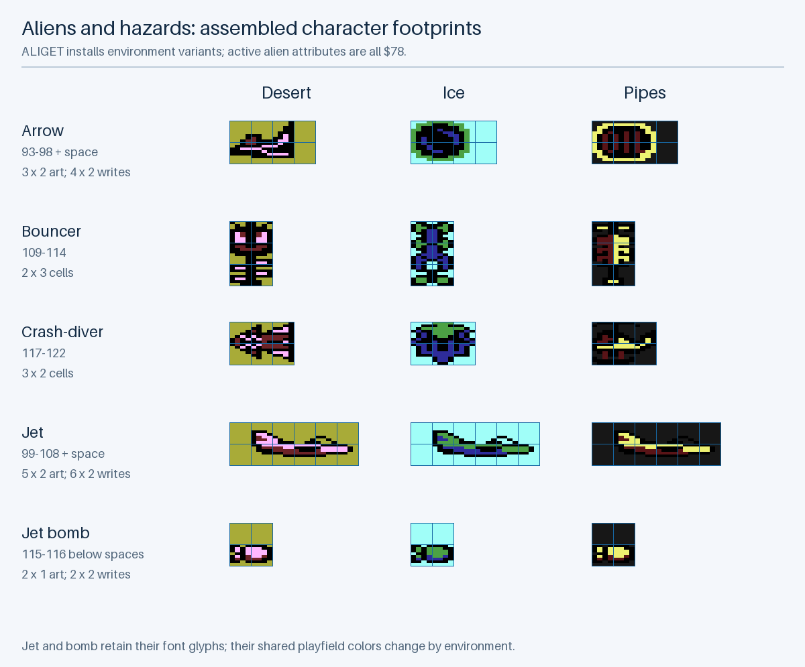
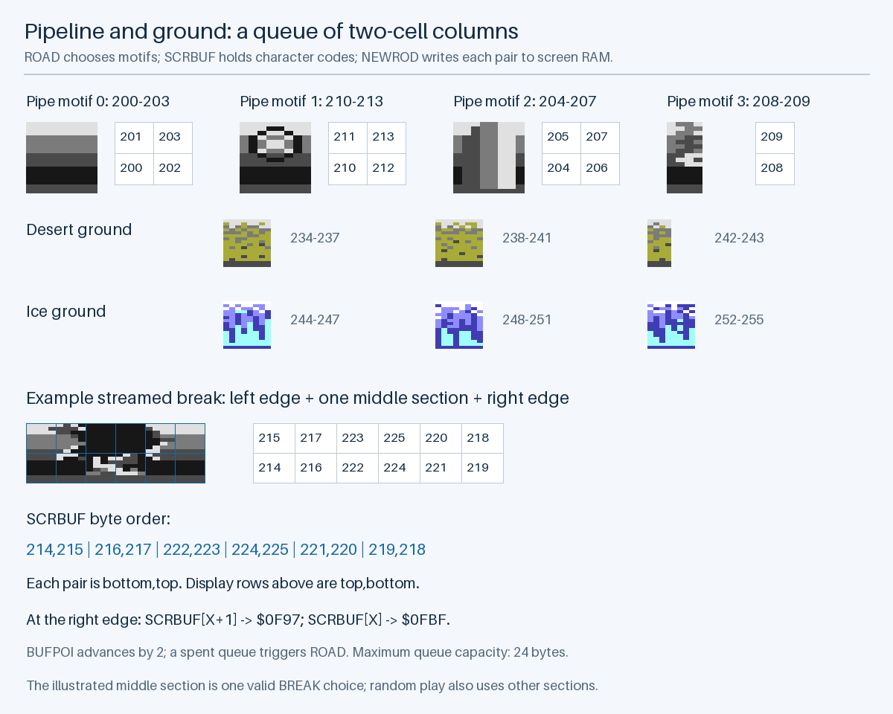
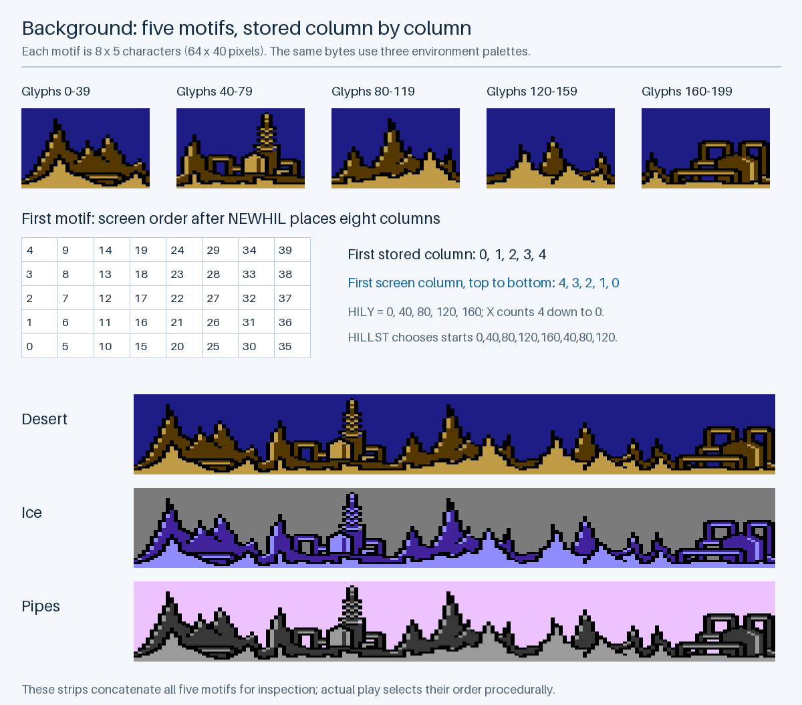
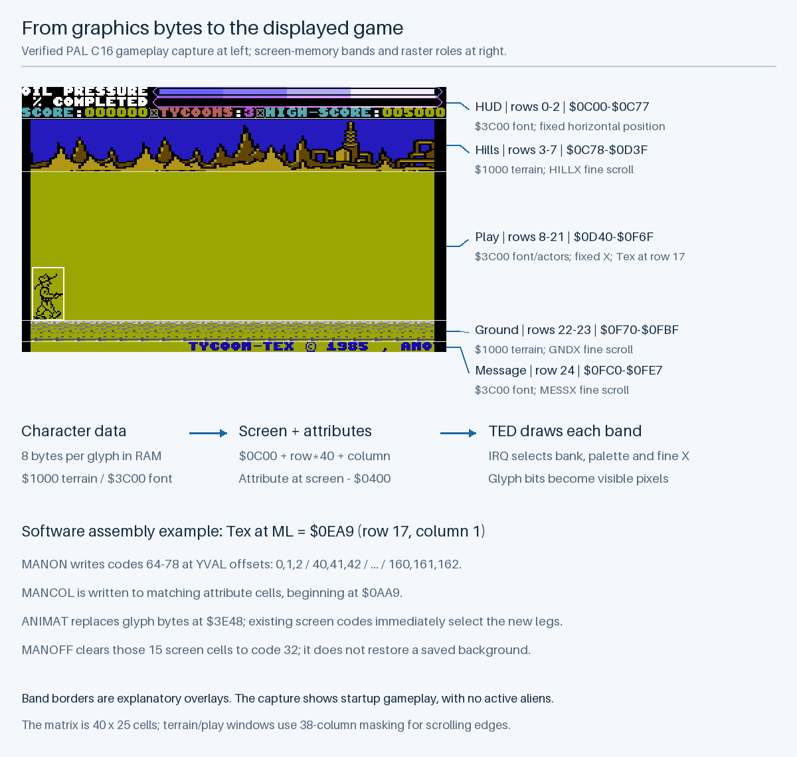
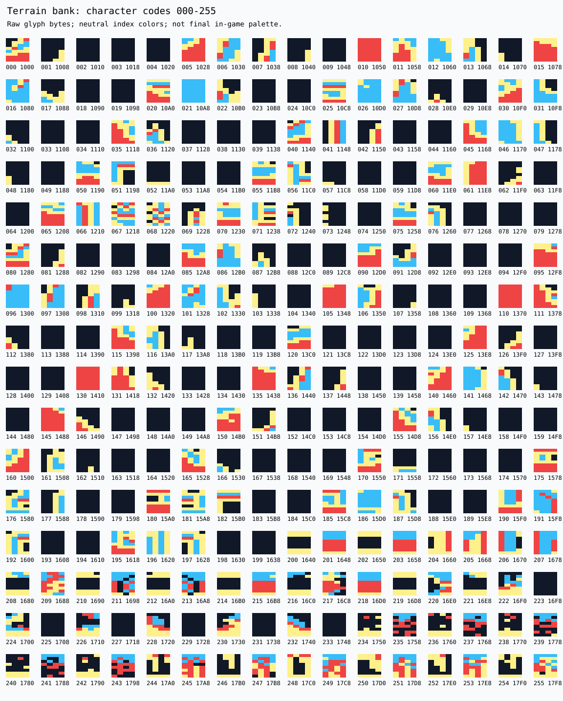

# Illustrated Graphics

## How These Figures Were Made

Every figure in this chapter is generated by `scripts/render_game_graphics.py` from the original bytes exported in [`asset-data.json`](analysis/asset-data.json), with nearest-neighbour enlargement. Nothing is redrawn by hand. The script needs Pillow 10.1 or later, so `make docs` doesn't run it: after changes to the asset data, run `python3 scripts/render_game_graphics.py` and then `make docs-html`. [Codebase Analysis](../CODEBASE_ANALYSIS.md) explains the code that uses these graphics.

---

## Font Assets and Runtime Glyphs

The selected font asset is `FRAK.BIN`, a `$3C00` load header and 1,024-byte payload. `CHARS.BIN` differs in 436 payload bytes and is not the playable output's selected font. `CHAR#2` and the separately assembled actor definitions also represent differing graphics material; they must not silently overwrite the selected font.

`ALIEN-CHRGET` deliberately replaces selected runtime glyphs from `CHAR-TABLES` for each environment. `ARRCHR`, `BACHAR`, and `SUCHAR` each contain three 48-byte sets. They are copied to `$3EE8`, `$3F68`, and `$3FA8` respectively. The normal player, meter, title, and effect routines modify other glyphs at runtime. The initial standalone font is consequently only the starting state of a dynamic asset bank.

The images below reconstruct the game's original graphics bytes and show their character-cell assembly. They use the active `FRAK.BIN` font, terrain payload, runtime replacement tables, and `SHTCOL` environment colors exported in `docs/analysis/asset-data.json`. Asset previews use VICE's [Colodore TED PAL palette](https://github.com/VICE-Team/svn-mirror/blob/main/vice/data/PLUS4/colodore_ted.vpl), with nearest-neighbor enlargement to preserve pixels. RGB appearance can differ from the existing emulator capture; the glyph bits and palette-register choices come from the game. Blue grids, numeric labels, and callouts are explanatory overlays.

---

## Main Character – Tex and His Walk Frames

Tex is **24 × 40 display pixels**, assembled from three columns and five rows of 8 × 8 glyphs. `MANON` writes consecutive character codes 64–78 through `YVAL`, whose offsets are `0,1,2`, then `40,41,42`, continuing down to `160,161,162`. These offsets map the row-major character sequence onto the 40-column screen. The matching attribute cells receive `MANCOL`.

Codes 64–72 form the static upper nine cells at `$3E00–$3E47`. Codes 73–78 form the lower six cells at `$3E48–$3E77`. `ANIMAT` copies one 48-byte slice of `ANDATA` over those six glyph definitions. The screen still contains codes 64–78; changing their backing glyph bytes changes Tex's visible legs wherever those codes are displayed. Each complete frame therefore combines 72 static bytes with 48 animated bytes.

`DECODE = 1,3,0,2` supplies the cyclic frame order, and `TIME6 = 0,48,96,144` converts a frame number to its byte offset. `ANINUM` advances before lookup, so the cycle's starting phase depends on its current value. The animation below illustrates the cycle at a fixed 200 ms per frame; actual game cadence depends on `ANISPD`, movement speed, pause, and animation flags.

Tex uses one-bit pixels even within the multicolor play window: his attributes are `$70` in desert/ice and `$71` in pipes, with attribute bit 3 clear. His outlines therefore retain eight individual pixels across each cell. The alien attributes have that bit set and use four double-width pixels instead. VICE's [TED character renderer](https://github.com/VICE-Team/svn-mirror/blob/main/vice/src/plus4/ted-draw.c) implements this per-cell mode choice and masks the cell color with `$77` in the multicolor window. Treating every actor as a two-bit image would distort Tex.

See `PRINT-MAN`, `ANIMATIONS`, and `TABLES` in the [code reference](analysis/CODE_REFERENCE.md#print-man) for the draw loop, copied frame bytes, and footprint offsets. Death rendering can switch to the separate `FALLY` footprint; the images above show the ordinary upright player.

---

## Aliens – Environment Variants and Draw Footprints

The renderer composes each hazard from screen character codes, just as it composes Tex. The table distinguishes the visible artwork rectangle from the full cells written by the routine. Blank cells are code 32 and can erase a previous position as the object moves.

| Object      | Character codes | Art cells | Written cells |
| ----------- | --------------- | --------- | ------------- |
| Arrow       | 93–98           | 3 × 2     | 4 × 2         |
| Bouncer     | 109–114         | 2 × 3     | 2 × 3         |
| Crash-diver | 117–122         | 3 × 2     | 3 × 2         |
| Jet         | 99–108          | 5 × 2     | 6 × 2         |
| Jet bomb    | 115–116         | 2 × 1     | 2 × 2         |

`PRARRO` uses `ARCHAR` and `ARY` to write three artwork cells and a trailing space on each row. `PRPLAN` uses `JTCHAR` and `JTARY` to write a leading space followed by five artwork cells on each row. `BALLS` writes codes 109–114 through `BALLY`; `KAMAZ` writes 117–122 through `KAMY`. Both loops count backward while decrementing the code, yielding the ascending screen layouts shown above. `BOMPRN` clears two cells at its pointer and draws codes 115 and 116 one row below, so its pointer addresses the cleared row rather than the visible bomb.

`ALIGET` selects byte offset `TIM48[AREA]`, or `0`, `48`, or `96`, into each environment-dependent glyph table:

| Table    | Destination   | Replaced codes |
| -------- | ------------- | -------------- |
| `ARRCHR` | `$3EE8–$3F17` | 93–98          |
| `BACHAR` | `$3F68–$3F97` | 109–114        |
| `SUCHAR` | `$3FA8–$3FD7` | 117–122        |

These are different drawings, not merely palette swaps: for example, the arrow's environment variants include round objects. The jet and bomb retain their selected font definitions, while the shared play-window colors change their appearance between environments. All five active hazard color variables receive `$78`; the older `MARIDA` color table is commented out.

---

## Pipeline – Tiles, Ground Motifs, and Break Assembly

The pipeline and ground occupy two character rows, or 16 display pixels in height. `PIPCHR` selects four motifs as `(start code, byte count)` pairs: `(200,4)`, `(210,4)`, `(204,4)`, and `(208,2)`. `DESCHR` selects the desert groups 234–237, 238–241, and 242–243; `ICECHR` selects 244–247, 248–251, and 252–255. These are terrain-bank codes, so their glyph addresses are `$1000 + code * 8`.

`PUTBUF` fills `SCRBUF` with consecutive codes, but **the buffer is column-oriented, bottom cell first**. For the first pipe motif, bytes `200,201,202,203` display as upper row `201,203` and lower row `200,202`. A direct row-major atlas does not show the assembled pipe.

`BREAK` uses the same paired layout to concatenate left-edge codes 214–217, one to three middle sections beginning at 222, 226, or 230, and right-edge codes in the descending order 221,220,219,218. The figure shows one valid six-column break using middle codes 222–225. Impact routine `PUTBRK` instead writes an explicit two-row pattern into terrain already on screen, using `HOLECH` and `HOLEYY`.

On each coarse ground scroll, `GNDHRD` shifts the two screen rows left by one cell. `NEWROD` then reads the next buffered pair: `SCRBUF[BUFPOI+1]` goes to `$0F97` at row 22, column 39; `SCRBUF[BUFPOI]` goes to `$0FBF` at row 23, column 39. It advances `BUFPOI` by two and calls `ROAD` when the motif is exhausted. `GNDX` supplies the intermediate pixel scroll before the next whole-column shift. The 24-byte buffer holds at most twelve two-cell columns, not a full landscape image.

---

## Background – Reconstructing the Hills and Buildings

Terrain codes 0–199 contain five hill/building motifs, each eight columns by five rows, or 64 × 40 display pixels. `HILLST` selects starting codes from `0,40,80,120,160,40,80,120`; the repeated entries weight selection toward some motifs. All environments reuse these tile bytes with different hill colors.

Each motif is stored **one column at a time, from bottom to top**. `NEWHIL` begins at the rightmost screen column, `$0C9F`, indexes `HILY` from 4 down to 0, and increments `HILCHR` after each write. Thus codes `0,1,2,3,4` become screen column `4,3,2,1,0` from top to bottom. The next column uses codes 5–9. For motif start `s`, cell column `c`, and cell row `r`, the assembled code is `s + c * 5 + (4 - r)`.

`HARHIL` shifts five rows left and calls `NEWHIL` to supply the new rightmost column. `HILLX` provides fine movement between those character shifts. Hills and ground have separate scroll phases and speeds, producing the moving background effect while the player window stays horizontally fixed. The figure concatenates all five motifs for inspection; it is not a fixed level map.

---

## Display Assembly – From RAM to the Screen

The display is a 40 × 25 character matrix, representing 320 × 200 pixels before border and scrolling-window masking. Each screen cell stores a character code at `$0C00 + row * 40 + column`; its attribute is 1,024 bytes earlier at `$0800 + row * 40 + column`. The glyph pattern lives in a separate RAM bank. These three inputs – screen code, glyph bytes, and color attribute – combine with the current raster window's registers to produce pixels.

For example, `ML = $0EA9` places Tex at row 17, column 1. `MANON` writes codes 64–78 at the fifteen `YVAL` offsets and writes his attributes beginning at `$0AA9`. In the play window, TED fetches those codes from the `$3C00` bank. The glyph for code 64 starts at `$3E00`; code 73 starts at the animation destination `$3E48`. `ANIMAT` changes that glyph memory, while movement changes screen-cell contents. `MANOFF` erases the old footprint to spaces without saving or restoring the covered background.

The raster handlers select the following logical bands; their programmed compare values and delayed register writes are described in [Interrupt Scheduling and Timing](../CODEBASE_ANALYSIS.md#interrupt-scheduling-and-timing).

| Band    | Rows  | Glyph bank | Horizontal phase |
| ------- | ----- | ---------- | ---------------- |
| HUD     | 0–2   | `$3C00`    | Fixed            |
| Hills   | 3–7   | `$1000`    | `HILLX`          |
| Play    | 8–21  | `$3C00`    | Fixed            |
| Ground  | 22–23 | `$1000`    | `GNDX`           |
| Message | 24    | `$3C00`    | `MESSX`          |

`RAST1` establishes the HUD settings and performs much of the software drawing. `RAST2` selects the hill bank and colors; `RAST3` selects the play bank and colors; `RAST4` returns to terrain for the ground; `RAST5` selects the upper font for the message. Fine-scroll masking uses a 38-column window around the scrolling content, while the HUD uses 40 columns. The screenshot annotations describe screen-memory bands, not exact instruction or register-write scanlines.

For a multicolor cell, each glyph byte becomes four pairs of display pixels. Pair `00` selects `$FF15` background, `01` selects `$FF16`, `10` selects `$FF17`, and `11` selects the cell color masked with `$77`. A cell with attribute bit 3 clear instead decodes eight one-bit pixels against the same window background. This allows Tex's fine outline and the aliens' multicolor artwork to share one playfield. The [TED renderer](https://github.com/VICE-Team/svn-mirror/blob/main/vice/src/plus4/ted-draw.c) provides an implementation reference for that mapping.

The annotated image uses the repository's verified gameplay-entry capture, which has Tex and scenery but no active aliens. The alien sheet shows reconstructed assets for all environments; it is not evidence that all five hazards appear together in that captured frame. This reconstruction does not simulate raster timing, analog video effects, or a complete game session.

---

## Reusable Graphics Reference

The [one-bit font atlas](analysis/font-hires.svg) and [two-bit font atlas](analysis/font-multicolor.svg) show all 128 upper-bank glyphs. Each tile is labeled with its decimal code and byte address. Preview colors identify raw indices and are deliberately not advertised as the game's final palette. The [asset JSON](analysis/asset-data.json) exports hex payloads, addresses, frame tables, and movement/palette lookup data.

For a raw glyph at address `base + code * 8`, one-bit decoding reads bits 7 through 0 across each row. Multicolor decoding reads pairs 7–6, 5–4, 3–2, and 1–0, expanding each pair to two display pixels. Palette selection belongs to the window and cell attributes, not to the glyph byte stream alone.

---

## Palette Records

`SHTCOL` has three 16-byte records. Offsets 0–3 select road shared/attribute/background colors; 4–7 select hill colors; 8–10 select play-window shared/background colors; 11 selects Tex's attribute; 12 the message attribute; 13–14 end-sequence flash colors; 15 is padding. `SETSHT` copies these fields into mutable variables.

The commented alien-color table `MARIDA` is not the active color policy: `ALIGET` currently installs `$78` for all five hazard color variables. Changing `MARIDA` alone will not change their colors.

---

## Text and Large Lettering

Ordinary source text is converted for display with `AND #$3F`, so ASCII letters are not directly identical to screen glyph numbers. `MESST` uses `$FF` as the scrolling-message terminator. `MESSVE` increments the pointer, inserts a glyph at the right edge, and wraps at that terminator. Editing text requires respecting the character encoding and termination rules.

`STARTER` and `KWAHERI` contain small bit-pattern tables for countdown and end lettering. They expand rows of bits into screen characters, using a filled-block glyph rather than a general bitmap surface. `DOUBLE-BIT` supplies title letter patterns; `GLOP-ANIMATIONS` animates decorative glyph bytes, and `FLASH-COLOURS` changes title attributes. `WHOOPPEE-MESSAGE` carries credits and promotional scrolling text.

The title's `TITTOP` loop stops on zero, but its declared sequence has no explicit zero byte: the following `CHSY` table begins with zero and supplies the terminator through adjacency. Keep this dependency in mind before moving or extending either table.

---

## Artwork, Inlay, and Press Material

The corrected standalone Tycoon Tex inlay, artwork variants, supplied screenshot, and 17-page scrapbook support visual design and contemporary context. Scrapbook page 5 contains a Tycoon Tex inlay and pages 11–12 contain reviews. The supplied screenshot is a reference capture; the repository's restored screenshots are captures of the rebuilt program.

These print and image assets are reference/design material, not runtime textures in the C16 executable. Their dimensions, text, and artistic treatment can inform a new presentation, but they do not specify hidden game logic. Their existing rights and credits are recorded in [Rights and Preservation](../RIGHTS.md).
