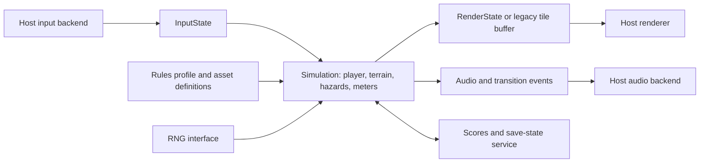

# Tycoon Tex – Modification and Porting Guide

## What This Guide Provides

This is my development plan for a derivative, based on the recovered C16 implementation. It sets out the interfaces, data formats, behavior choices and acceptance tests I'd use. I haven't built a modern engine, a variant build target or a platform port yet.

Read the [codebase analysis](../CODEBASE_ANALYSIS.md) first. The [generated reference](analysis/CODE_REFERENCE.md) has module locations, symbol addresses and source-line numbers, and the [asset data](analysis/asset-data.json) has the raw graphics and the important tables. The original preservation build and `v1.0.0` stay as the comparison baseline.

---

## Choose the Intended Compatibility Contract

A source-compatible C16 derivative changes the recovered implementation but keeps its hardware and character-memory model. It's the shortest route to new levels, revised balance or replacement artwork, though it stays tied to raster timing, writable code and a nearly full memory layout.

An emulated original on another host keeps the CPU, memory, TED and KERNAL behavior inside an emulator. The work is in host input, audio and video presentation, packaging and persistence. The hardware behavior survives without translating each routine, but you need a suitable emulation implementation and your own integration testing.

A native reimplementation turns the game rules into a platform-independent model and adds new input, graphics, audio and persistence backends. It's the most flexible route for new versions. It also has to deal explicitly with character-based collision, two update cadences, dynamic glyph graphics and the differences between the source and running versions.

These are three different deliverables, so decide which differences are intentional before calling anything a faithful port. The game could also support separate compatibility and redesigned rule profiles, as long as each is tested and documented.

---

## Preserve a Stable Baseline While Developing

The default `restore_c16.py` is strict on purpose. Editing a historical module changes the output and should fail the comparison with `OBJ`, and the regression test also checks a complete PRG hash. Don't remove either casually, because together they protect the historical reference while a derivative evolves.

My proposal for variants is to keep normalized editable assembly or translated code in a new derivative directory, write to a separate output directory and manifest, and use variant-specific expected results. There's no `--variant` or `--skip-validation` flag today. Don't document or depend on one until it exists.

For a future assembly variant builder, keep the original source-selection code, add an explicit override manifest, assemble the selected working modules, and report both the source provenance and the byte differences from the baseline. The original target should still fail strictly. Set a new binary baseline only after the derivative's behavior has been reviewed.

Graphics need the same separation. Changing the comparison-only `SET#2` source won't affect the playable font, because the default output uses `FRAK.BIN`. A variant has to select its new graphics inputs explicitly, including any runtime replacements from `CHAR-TABLES` and `ANDATA`.

---

## Proposed Portable Architecture

These boundaries are my proposals. None of them exists as a class in the repository.



`SessionState` should hold the selected difficulty, lives setting, control mode, sound setting, current screen state, and the persistent high-score table. `WorldState` should hold the level/environment, scroll phases, terrain queue, actor states, pressure/progress, score, and RNG state. Temporary render pointers should not be the only location of authoritative state.

`InputState` should expose left, right, jump/up, menu-down, fire, pause, resume, escape, and control-mode selection. The original sign-bit flags can be mapped to booleans at the compatibility boundary. Host key bindings should be configurable rather than tied to Commodore matrix rows.

`RenderState` should describe HUD values, scrolling layers, actor footprints or sprites, palette regions, presentation lettering, and any dynamic tile replacements. `AudioEvent` should distinguish fire, successful hit, and completion-bonus behavior. `Persistence` should handle modern high-score saving independently of the original in-memory table.

An initial compatibility implementation can retain a 40-by-25 tile grid as part of its simulation model. This makes the original numeric collision contracts and read-before-draw behavior easier to reproduce before replacing them with semantic hitboxes and independent rendering.

---

## Schedule Video and Foreground Work Separately

The original video phases and foreground loop do not share one fixed iteration rate. A new frame loop that updates every object exactly once per frame will change ball speed, crash-object speed, pressure drain, input latency, and scoring/progress relative to arrows and jets.

First capture video-phase counts and foreground-loop counts over known actions and difficulty settings in VICE. Include idle walking, maximum travel speed, multiple hazard types, active explosions, and transitions. Interrupt cost and the busy-loop workload affect the foreground cadence, so one measurement at the title screen is insufficient.

A proposed high-level scheduler is:

```text
advance host elapsed time
while a video interval is due:
    apply video-phase work in the chosen legacy order
    sample input at the documented point
    update frame-based actors, glyphs, and audio
while a foreground interval is due:
    update pressure tempo and slower hazards
    update walking score and progress
    advance any foreground transition state
render the latest presentation state
```

This is deliberately conceptual. The final relative frequency needs measuring, so I haven't specified one. A nominal 50 Hz video interval is a reasonable PAL-style starting point and doesn't prove cycle equivalence. An emulator-based implementation can keep CPU-cycle scheduling, and a native reinterpretation can use new timing once the change in feel is documented.

Convert waits into transition states. `LVLOVR` waiting for `DEAD` to clear must allow death updates to continue. Name entry, countdown, oil failure, bonus conversion, and the end presentation likewise need progress across host frames, not blocking loops that prevent input, audio, or redraw.

---

## Translate Coordinates Without Losing the Rules

The original address model maps a screen cell to `$0C00 + row * 40 + column`. `ML` initially identifies row 17, column 1. The player spans three columns and five rows, while the ground occupies rows 22–23. Horizontal movement and jumping change the address by 1 and 40 respectively.

Keep a logical character-grid coordinate system for the first translation. Ground and hills also need a fine-scroll phase from 0 to 7. A renderer can interpolate or scale this grid later, but simulation should not inherit host window dimensions or floating-point rounding accidentally.

Player position selects a travel-speed profile at columns 1, 4, 7, 10, 13, 16, 19, and 22. Between those columns the previous profile persists. The original rightward key therefore changes both visible placement and world speed. Treating it only as a generic positive player velocity loses a central control relationship.

The jump rises five cells and falls five cells on a discrete counter schedule. A redesigned ballistic jump should be a separate rule profile with tests for gap clearance and firing height. Collision width/height should be derived from actual footprints before substituting visually smoother sprites.

---

## Asset Extraction and Rendering Plan

The generated [terrain atlas](analysis/terrain-multicolor.svg) decodes all 256 terrain glyphs. The [one-bit font atlas](analysis/font-hires.svg) and [two-bit font atlas](analysis/font-multicolor.svg) decode the 128-glyph upper bank in both interpretations. Neutral colors identify bit/pair values; they do not encode the game's final palette.

The asset JSON uses hexadecimal payload strings with addresses and lengths. It contains the 2,048-byte terrain bank, the 1,024-byte selected font, walking frames, environment-specific arrow/bouncer/crash graphics, title lettering, palettes, and speed/progress tables. A port can decode those bytes into indexed textures or keep the tile format directly.

For a multicolor glyph, each of eight bytes supplies four indices in order from the most significant pair to the least significant pair. Expand each index to two horizontal display pixels. For a hires glyph, read eight bits across each row. Preserve separate window palettes and per-cell attributes when reconstructing actual colors.

### Construct Complete Actor Frames

Tex's standing/walking footprint is 15 glyph cells. The upper nine remain in the selected font, while `ANIMAT` replaces the lower six with 48 bytes from `ANDATA`. Assemble the full footprint for each animation state; do not mistake a six-glyph lower-body frame for an entire character.

Arrow and crash graphics use six glyphs per environment. The bouncer also uses six, arranged in a two-column by three-row footprint. Their runtime install addresses and screen-code tables are defined in the source. Blank cells in the arrow and jet footprints are intentional trail-erasure behavior.

Death rotates and shifts the player glyphs, while title lettering temporarily reuses hazard glyph addresses. A modern renderer can replace these mutations with explicit animation frames. Keep the original mutations as a reference until the new frames are visually and behaviorally validated.

### Reconstruct Terrain as Structured Data

The first 200 terrain glyphs form five hill motifs in column-oriented groups, not a conventional row-major level map. The remaining glyphs cover pipe pieces, breaks, desert, and ice. Road motifs use start-code/count pairs and the queue consumes upper/lower character pairs in a defined order.

A proposed exported format should name a tile's semantic role, dimensions, palette policy, and collision category separately from its historical character code. Retain the original code as metadata for trace comparison. Avoid interpreting generated scenery as a fixed list of pre-authored levels.

### Treat Text as Encoded Content

Ordinary source strings often become screen codes through `AND #$3F`, and the message uses `$FF` as its terminator. A Unicode text system can preserve the visible words while using a deliberate character mapping for the original font. Title/table adjacency and implicit terminators must become explicit lengths or terminator fields in exported data.

The artwork and cassette scans provide design references for a new title screen, cover, or higher-resolution presentation. They are distinct from runtime tile assets and retain their recorded attribution and rights status.

---

## Rules That Need an Explicit Compatibility Choice

| Rule                       | Source behavior to preserve or change |
| -------------------------- | ------------------------------------- |
| Extra lives                | Thousands digit; running version 10k  |
| Pressure across a boundary | Borrow once, reset fine part to 7     |
| Completion signal          | Set on a later `COMPUP` call          |
| Score representation       | Six screen-resident ASCII digits      |
| Level representation       | Packed BCD                            |
| Spawn-frequency bands      | BCD mask, including wrap after 79     |
| Jump path                  | Discrete row changes                  |
| Bullet/explosion capacity  | One of each                           |
| Collision authority        | Screen character codes and order      |
| Pause/resume               | Separate Space / Commodore actions    |
| RNG                        | Timer and CPU-carry dependent         |
| High-score persistence     | In-memory only                        |

The five [routine probes](analysis/rule-probes.json) establish concrete arithmetic cases for extra lives, pressure, and completion. Use those as initial conformance fixtures. They do not substitute for testing score overflow, unusual accumulator values, multiple hazards, or interrupted execution.

For a new design, numerical score, linear meters, explicit collision layers, multiple projectiles, richer animation, and persistent high scores can all be sensible changes. They should appear in a documented derivative rules profile rather than being described as behavior recovered from the original.

---

## Hardware Responsibilities to Replace

A native renderer replaces the raster windows with layered drawing: fixed HUD, scrolling hills, playfield actors, scrolling ground, and scrolling message. Per-window colors can be expressed as palette/material state. A hardware-specific assembly port must instead redesign the timing, display memory, and sprite/tile strategy for its target.

Input backends replace `$FD30` and `$FF08` matrix/latch accesses. The original joystick routine patches an opcode to normalize fire bits; a native input adapter should normalize device data directly. Keep the original sampling point and distinguish menu input from gameplay actions.

Audio backends replace TED frequency/noise register writes. Preserve fire-sweep, successful-hit, and bonus-conversion event trajectories if authentic sound is the goal. New music or samples are additional authored content, not hidden assets waiting to be extracted.

A portable RNG should have explicit seed/state serialization and a documented sequence. Reproducing the old generator exactly requires accounting for timer inputs, carry, and call order. Substituting a generator is easier to test but produces different scenery/spawn sequences even when its distribution looks similar.

Remove self-modifying instruction dependencies by replacing patched opcodes and operands with explicit data selections. Introduce named entries for `SCORE+2` and `DELAY+2` equivalents. Keep writable scores and menus in state rather than program text. Avoid porting the original KERNAL IRQ stack assumptions into a new interrupt handler.

---

## Target Families and Likely Work

| Target family       | Principal adaptation                      |
| ------------------- | ----------------------------------------- |
| Desktop native      | Portable simulation, renderer, input      |
| Browser             | Same model; browser audio/input lifecycle |
| Embedded display    | Frame budget, buffers, input and audio    |
| Another 8-bit CPU   | Memory model, timing, toolchain rewrite   |
| Another 6502 system | Video/input/audio and memory relocation   |
| Emulator host       | Emulation integration and packaging       |

These are architecture categories. None of them is finished support, and I'm not promising performance on any particular board. I haven't picked an engine, language, display resolution, controller or target device. A target-specific implementation should start from that target's real memory, graphics, timing and build constraints.

---

## Suggested Development Milestones

1. Define whether the derivative follows the source revision, the supplied running revision, or a new rules profile. Record extra-life policy and any planned corrections before implementation.
2. Load and decode the terrain/font data, reproduce a known screen, and establish palette and character-code mapping. Verify complete Tex frames and all three environment actor sets.
3. Implement a deterministic state model with injected input and RNG. Reproduce player speed profiles, the discrete jump, and road-column consumption before adding all hazards.
4. Add each hazard with its original footprint, spawn gate, update cadence, and erase behavior. Preserve the one-slot limits initially to reduce ambiguity.
5. Add pressure, progress, score, death, completion bonus, demo, and high-score entry. Turn blocking source sequences into explicit transition states.
6. Compare traces and screenshots against VICE, then implement the selected platform backend and any explicitly designed improvements.

These milestones are my suggestion. A first playable slice should show scrolling ground, one environment, player movement and jump, and one hazard with repeatable input, rather than piling up untested presentation features.

---

## Conformance and Regression Test Plan

Maintain the existing eight preservation tests unchanged for the original target. Add a separate derivative test suite whose expectations are named by rule profile. Check data export against original bytes so a renderer failure can be distinguished from an extraction failure.

Record fixture inputs, initial state, RNG state, update phase, expected next state, and expected events. A useful trace should include player coordinates/profile, scroll phases, terrain queue position, hazard slots, pressure/progress components, score/lives, and mode/transition flags. Capturing state at the same phase boundary avoids comparing one version's pre-update state to another's post-update state.

The first focused fixtures should cover speed-table boundaries, jump completion, tile thresholds, bullet sentinel termination, all hit awards, pressure borrowing, completion carry, source/running extra-life policy, paused updates, death restoration, and environment transitions. Add high-score ties/insertion, six-digit overflow, packed-BCD rollover, and overlapping impact damage before claiming broader equivalence.

Visual comparison needs stable scene state and an identified raster/frame capture point. Pixel similarity alone cannot prove collision or score equivalence. Conversely, state equivalence does not prove correct palette switching, sound, input mapping, or animation composition.

For timing, measure both video and foreground cadences and compare at each difficulty. For sound, capture original register trajectories or audio before asserting reproduction. Existing startup screenshots and five arithmetic probes are a useful starting point, not an exhaustive compatibility certification.

---

## Open Work Before a Complete Port

I still need longer deterministic VICE traces, full manual input checks, a listen to the sound, coverage of every level, death and session transition, and decisions on the score and gauge quirks I found. I haven't worked out what several of the legacy development binaries do. I've recorded where they came from and where my knowledge stops, and I haven't invented a toolchain feature to fill the gap.

Once I've chosen a target platform, the next task is a small architecture and build proposal for it, then an asset-decoding and player/terrain prototype. The preserved C16 output, source catalogue, atlases and rule fixtures are what I'll measure that work against.
