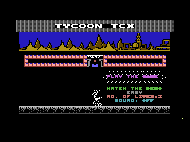
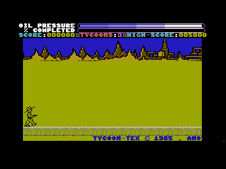

# Source and Validation

## Result – 20 October 2026

The rebuilt PRG contains 12,288 memory bytes plus a two-byte `$1000` load header. It starts execution at `$1800` on a 16 KB PAL C16.

| Measurement                 | Result                    |
| --------------------------- | ------------------------- |
| Complete PRG                | 12,290 bytes              |
| Main source region          | 9,203 bytes               |
| Object-listing bytes        | 9,179 bytes               |
| Reserved work buffer        | 24 bytes                  |
| Object-listing differences  | 0                         |
| Terrain source/listing diff | 0                         |
| Regression tests            | 8 passing                 |
| Emulator                    | VICE 3.10, PAL C16, 16 KB |

The verified output SHA-256 is:

```text
09c9d0e3120e847f63c19b24560d46d08f15a48bfacb6956de01230e15cffbcd
```

The packed running PRG I have hashes to:

```text
87b99fcdbb0de146b2d373ec11ef7f759175544c37659e47aaa880d3693b253f
```

The [build comparison](verification/build-comparison.json), [VICE report](verification/vice-verification.json) and [source manifest](verification/source-manifest.json) are the evidence for this checkpoint. The [tool checks](verification/tool-checks.json) record the build agreement and the independent disk extraction check. Every new build writes fresh reports to its output directory.

---

## Source Selection and Assembly

The main input is `Original Source Recovered/2026/TycoonTex-C16.d64`. Its 56 live files match the 2026 extraction byte for byte and pass the hashes in the extraction manifest. Modules missing from the disk come from the 1992 export, and its `INDEX` ties the Commodore filenames back to the shortened PC filenames, including names with `/`, `#` and spaces.

The main source is the older `TYCOONTE.SEQ`, mapped to `TYCOON-TEX`, and its original `.LIB` order is kept. The main assembly expands 59 modules: 36 from the fresh disk and 23 fallbacks. For the older text exports the build restores uppercase source and universal newlines without rewriting the files. Every include has to resolve to exactly one file, and a missing, ambiguous or recursive reference fails the build.

VICE's separate `c1541` disk utility extracted `OBJ` independently, and its output matched the 2026 extraction byte for byte.

The syntax converter keeps instructions after labels, equates, self-modifying operands, literal text and the two original macros. ca65 and ld65 assemble and link at the fixed addresses. `OBJ` is a MOS Technology hex-format object listing, not an assembly module. Its record lengths, checksums and terminal record count are checked before any comparison, and all 9,179 of its bytes match the reassembly. The 24-byte `SCRBUF` reservation at `$25E1–$25F8` has no records in `OBJ`, so the linker fills that output space with zeros.

### Memory Layout

| Address range  | Content                       |
| -------------- | ----------------------------- |
| `$0002–$00FF`  | Zero-page variable region     |
| `$0400–$04A7`  | Saved Tex character workspace |
| `$0560` onward | Double-width title workspace  |
| `$1000–$17FF`  | Terrain and pipe graphics     |
| `$1800–$3BF2`  | Main assembled code and data  |
| `$3BF3–$3BFF`  | Zero-filled output gap        |
| `$3C00–$3FFF`  | Supplied complete font asset  |

The first three regions are workspace, not PRG payload. The main linker configuration is `config/c16.cfg`, and the generated graphics configurations keep their original individual origins.

---

## Graphics Provenance

`SET#1-CHAR/ASSEM` assembles nine terrain blocks, taking the fresh disk first and older modules only where needed. All 2,048 bytes match the original `CHAR#1` hex listing. The complete font comes from the surviving 1,026-byte `FRAK.BIN` file, load header at `$3C00` included. Its 1,024 payload bytes differ from the running version's decompressed upper font at `$3FFF` only.

`CHARS.BIN` is about the same size but a different graphics revision: 436 payload bytes differ from `FRAK.BIN`. I've kept it, but it isn't the font input. The earlier actor definitions in `SET#2-CHAR/ASSEM` and `CHAR#2` also differ from the game-ready font. They're kept and assembled for comparison, and they never overwrite `FRAK.BIN` in the playable output. The old `CHAR#2` listing differs from that final font at 106 of its 263 recorded addresses.

Every graphics dependency is either a surviving standalone asset or assembled source. The rebuild never copies executable or graphics bytes from `Original Artifacts/tycoon_tex.prg`.

---

## Comparison with the Running Version

The running PRG is compressed, so comparing the raw files would compare two different formats. VICE runs its BASIC-stub entry at `$100D` and stops at `$1800`, before the first game instruction. The script saves `$1000–$3FFF` and compares that decompressed memory with the rebuilt payload.

Across the addresses in `OBJ`, exactly one byte differs: `$3262` is `$58` in the source build and `$57` in the running version. It is the low byte of `LDA SCRPOS+2` at `$3261`. The source reads `$0C58` and the running version reads `$0C57`. The instruction sits in the scoring routine, and its source comment names the thousands digit. The build keeps the source instruction. I don't know why the two revisions differ or everything the difference does in play. The [isolated routine probes](verification/rule-probes.json) did confirm one effect: adding a point at score 999 grants an extra life in the source build and not in the running reference. The [codebase analysis](../CODEBASE_ANALYSIS.md#confirmed-sourcerunning-version-difference) explains the thousands and ten-thousands digit distinction.

There are 41 differences across the full memory comparison:

| Region                   | Different bytes |
| ------------------------ | --------------- |
| Terrain `$1001–$1002`    | 2               |
| Reserved `SCRBUF`        | 24              |
| Score operand `$3262`    | 1               |
| Output gap `$3BF3–$3BFF` | 13              |
| Last font byte `$3FFF`   | 1               |

The reserved buffer and output gap start with different contents. I've recorded the other differences as they are, without quietly patching the source or importing reference bytes. The result is a source-accurate reassembly alongside a closely related running version. It doesn't make the two identical, and it doesn't show that either one is the definitive retail master.

---

## Emulator Evidence and Limits

VICE renders the title and runs the normal game initialization and countdown. The verification script stops at the original `BIT JFIRE` menu test, sets the fire-input flag and resumes the existing code. The game reaches `LOOP` at `$2A24` with `TITLE = 0` and `LIVES = 3`. No instructions are patched, and the script never jumps straight into the game loop.





The screenshots have been checked by eye. The test shows that the game renders and starts gameplay from scripted input. I haven't verified manual keyboard mapping, joystick operation, sound, collisions, scoring over a full game, level transitions or a complete play-through, and I haven't tried it on a physical C16.

---

## Recovery Background

My original development environment and the disk and source recovery are covered in [Dorks Dilemma C16](https://github.com/anthonyjclarke/Dorks_Dilemma_C16) and its [History and Credits](https://github.com/anthonyjclarke/Dorks_Dilemma_C16/blob/main/docs/HISTORY_AND_CREDITS.md). This document sticks to Tycoon Tex's inputs, build and validation.
